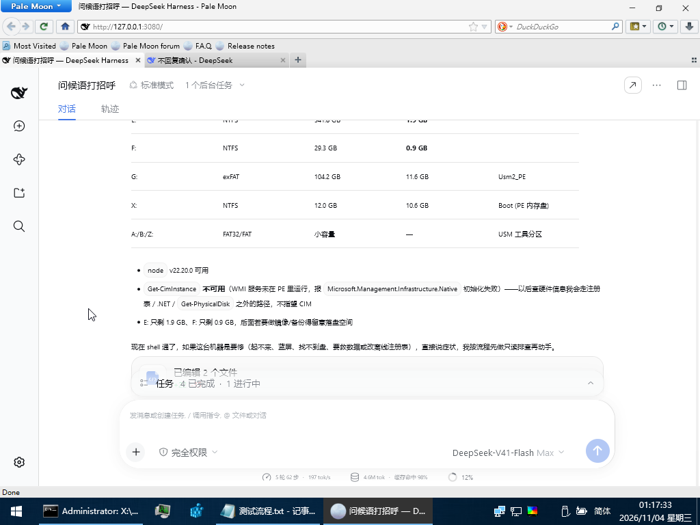

<div align="center">

# 🚑 dsh-rescue

### A rescue distribution for DeepSeek Harness

> **Rescue that intervenes at any moment.**
>
> **任何时候的介入急救。**


When Windows won't boot. When the PE has no browser. When even the shell is gone — it still answers.

**📌 Current version: v1.0.0** · [Changelog](./CHANGELOG.md)

[中文主页](./README.md) · [Full reference](./README.zh.md) · [PE runbook](./docs/pe-runbook.md)

<br/>



<sub>↑ Real capture: inside WinPE, the agent audits its own environment — lists partitions, notices WMI is down, warns that E: and F: are too small for image backups</sub>

</div>

---

## 🧭 Why it exists

AI agents assume a working PC. But they are needed exactly when the PC stops working:
no boot, blue screen, lost partition table, forgotten password, a disk with 900MB left.

`dsh-rescue` fits into a 16GB USB stick. Plug it into any machine and the agent can
ask questions and fix things **without installing an OS, a browser, or PowerShell**.

Two deliverables:

1. **A real DSH plugin** (`dsh-plugin-degraded`) — probes the environment, disables what
   cannot run, and tells you why.
2. **A ready-to-use PE bundle** (`dsh-pure`) — node, kernel, browser, PowerShell, rescue skills.

No fork, no kernel patches: everything is bundle patch / profile patch / `--patch` overlay.

---

## ✨ Features

| | Feature | Detail |
|---|---|---|
| 🧰 | **Six rescue skills** | Triage, boot repair, disk repair, data rescue, offline registry, password reset |
| 🖥️ | **Bundled browser** | Pale Moon portable — the UI opens inside the PE, no phone needed |
| ⚡ | **Bundled PowerShell 7** | 7.6.9 portable; commands actually execute |
| 🔌 | **Zero install** | Copy the folder to USB; no registry, no drivers |
| 🧠 | **Adaptive degradation** | Probes shell / PTY / GPU / browser / writable disk, disables what is missing |
| 🎨 | **Small-screen ready** | Works at 1024×768: 85% rendering, hidden bookmarks bar, window above the taskbar |
| 🌏 | **Bilingual** | UI and docs in Chinese and English |
| 💾 | **Reversible** | Every downgrade has a switch; config has four priority layers |

---

## 🖥️ Platform support

| Platform | Status | Notes |
|---|---|---|
| **Windows PE** | ✅ Supported | Primary target. node + kernel + PowerShell 7 + browser all bundled; verified on USM/MicroPE |
| **Windows 10 / 11** | ✅ Supported | Tray launcher, double-click and go; the degradation plugin works on a healthy system too |
| **Linux** | 🚧 Planned | node and the kernel are cross-platform and the probe already branches per platform; what is missing is Live USB packaging |
| **macOS** | 🚧 Planned | The path exists (Darwin prebuilds are already in the dependency tree) but signing and Apple Silicon make it lowest priority |
| **Windows RE** | 🔜 Future | Same lineage as PE so it should run; the blocker is that WinRE ships almost no NIC drivers — networking has to be solved first |

> "Planned" means a design judgement only: no implementation and no promised date.
> "Future" has had a feasibility pass; see below.

### Windows RE (future)

WinRE shares the PE lineage, so node, kernel, PowerShell and the browser should run as-is.
It is also far easier to reach than a PE stick: every Windows 10/11 ships one, F8 gets you in.

The real blocker is **networking**: WinRE carries only basic storage drivers and almost no
NIC drivers (wireless especially). The agent is useless offline, so this path needs either
injected drivers (`dism /add-driver`) or an acceptance that "network first, then WinRE".

Quick check: open the WinRE command prompt and run `ipconfig`. An address means it is feasible;
an empty list means a driver problem.

---

## 🚑 Six skills

| Skill | When |
|---|---|
| `pe-triage` | "Won't boot / BSOD / no disk" — read-only fact finding first |
| `pe-boot-repair` | Black cursor, repair loop, `0xc000000f`, `0xc0000225`; UEFI and Legacy |
| `pe-disk-repair` | Read-only disk, filesystem errors, partition table, bad sectors |
| `pe-data-rescue` | Disk readable but OS dead — copy out first, repair later |
| `pe-offline-registry` | Kill a bad service, fix startup, load/unload hives |
| `pe-password-reset` | Local account password, utilman swap plus restore |

Each one documents preconditions, exact commands, **why each flag matters**, and red lines.
Example: `robocopy` needs `/R:1 /W:1 /XJ` (the default retries a million times and hangs on
a failing disk), and `/MIR` must never be used (it deletes files on the destination).

---

## 🚀 Quick start

### Easiest: grab the prebuilt bundle

Don't want to build it? Get **`dsh-rescue-1.0.0-winpe.zip`** (362 MB) from
[Releases](https://github.com/XIZRSAMS/dsh-rescue/releases), unzip, then:

1. Copy the `pure` folder to your USB stick (renaming to `dsh-pure` is optional)
2. Edit `apikey.txt` and set `DEEPSEEK_API_KEY=sk-your-key`
3. Boot the PE and double-click `start-dsh.cmd`

The bundle already contains node, the kernel, PowerShell 7, the browser and six skills —
nothing needs to be installed or downloaded.

> Note: 28 .NET reference assemblies under `pwsh/ref/` were skipped at packing time
> (the files were locked). They are compile-time references and are not needed at runtime.

### Plugin only

```sh
git clone <this repo> dsh-rescue
cd dsh-rescue
node scripts/setup.mjs
node scripts/verify.mjs --all
```

### Full PE bundle

```sh
node scripts/setup.mjs
node scripts/a/provision.mjs
node scripts/pack-pure.mjs
```

External components (Pale Moon, PowerShell 7) are not committed. See
**[docs/pe-runbook.md](./docs/pe-runbook.md)**.

```powershell
robocopy dist\pure G:\dsh-pure /E
```

Inside the PE, run `start-dsh.cmd`; it prints three lines:

```
[dsh] credentials: loaded from G:\dsh-pure\apikey.txt
[dsh] pwsh: G:\dsh-pure\pwsh\pwsh.exe
[dsh] url: http://127.0.0.1:3080/?token=...
```

---

## ⚙️ How it works

| Hurdle | Solution |
|---|---|
| Can node run in PE? | Official builds are static CRT, system DLLs only |
| No browser in PE | Bundle Pale Moon portable; it ships its own api-ms-win-* |
| Engine too old | Inject an `AbortSignal.any` polyfill into `dsh-client-connection` |
| No PowerShell | Bundle PowerShell 7 portable (self-contained, no .NET needed) |
| No ping/ipconfig | Launcher is pure node, no cmd externals |
| API key | Launcher reads `apikey.txt` and sets `DEEPSEEK_API_KEY` |
| WMI down | Skills provide `net start winmgmt` and non-CIM fallbacks |

---

## 📋 Known limits

| Symptom | Cause | Fix |
|---|---|---|
| `Get-CimInstance` fails | WMI not started in PE | `net start winmgmt`, or use `Get-Partition`/`Get-Volume` |
| UI clipped | PE defaults to 1024×768 | Already renders at 85%; F11, or raise the resolution |
| `AbortSignal.any is not a function` | Old browser engine | The packer injects the polyfill; otherwise use a newer browser |
| No network | Missing NIC driver | Install the driver or use ethernet; `net-check.cmd` diagnoses |
| `Get-ChildItem` not recognised | cmd shim instead of real pwsh | Make sure `pwsh/` exists and is on PATH |

---

## 📝 Changelog

### v1.0.0 (2026-11-04) — current release

**✨ Added**

- **WinPE bundle**: node runtime + kernel + PowerShell 7 + Pale Moon in one folder. Copy to USB, run, done — no registry writes, no driver install.
- **Six rescue skills**: triage / boot repair / disk repair / data rescue / offline registry / password reset, picked automatically by symptom.
- **Dependency-free launcher**: `pe-boot.mjs` does everything in node — locate runtime, inject the API key, capture the token, open the browser. No cmd externals.
- **Tray launcher**: on desktop Windows, double-click `dsh-rescue.exe`; it parks in the tray and opens the tokenised URL.
- **Adaptive degradation**: probes shell / PTY / GPU / browser / writable disk, disables what is missing, explains why.
- **Bilingual**: UI and docs in Chinese and English.
- **Small-screen ready**: 85% rendering, hidden bookmarks bar, window sized above a 1024×768 taskbar.

**🐛 Fixed**

- `AbortSignal.any is not a function` on old engines: client polyfill (plus `throwIfAborted`, `structuredClone`, `crypto.randomUUID`).
- `ping` / `ipconfig` / `timeout` missing in PE: launcher rewritten in pure node.
- No PowerShell in PE: ships PowerShell 7.6.9 portable (self-contained, no .NET).
- `dsh-spill-local` EPERM when `%TMP%` is read-only: pinned to `runtime/tmp`.
- `Get-CimInstance` unavailable in PE: skills document `net start winmgmt` and non-CIM fallbacks.
- API key and session credentials leaked into packages: `pack-pure` now wipes them and writes an empty template.
- Browser window larger than a 1024×768 screen: 1000×700 and two toolbars hidden.

**🧩 Earlier**

- v0.1.0 (2026-11-03): first usable release — `dsh-plugin-degraded`, the A-side portable runtime, acceptance pipeline.

Full history: [CHANGELOG.md](./CHANGELOG.md).

---

## 📄 License

MIT. Unofficial distribution, not affiliated with DeepSeek.

---

<div align="center">

**Rescue that intervenes at any moment.**

🚀 Still evolving!

</div>
