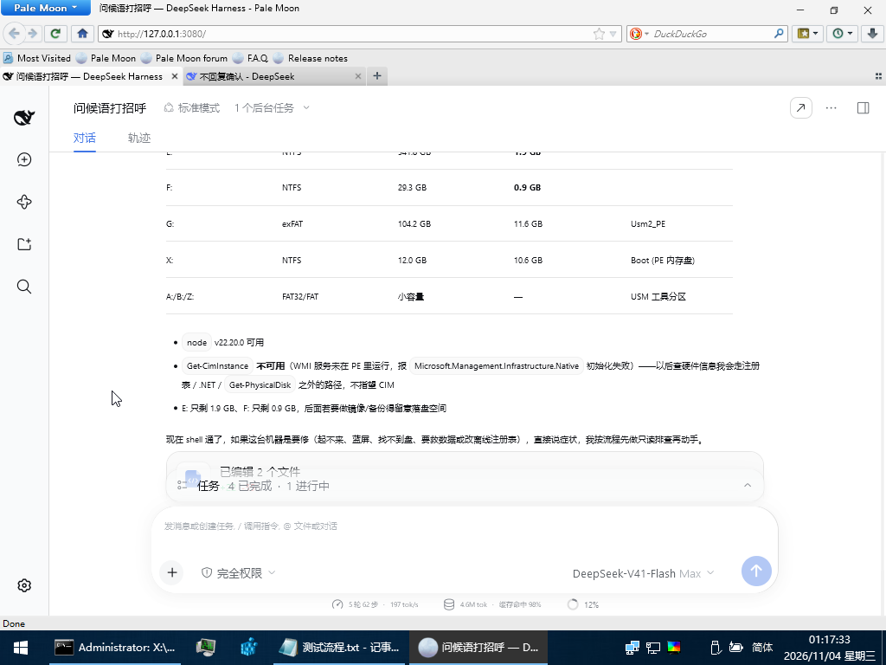

<div align="center">

# 🚑 dsh-rescue

### DeepSeek Harness 的救援发行版

> **任何时候的介入急救。**
>
> **Rescue that intervenes at any moment.**


系统起不来的时候，PE 里没有浏览器的时候，连 shell 都没有的时候——它仍然在。

**📌 当前版本：v1.0.0** · [更新日志](./CHANGELOG.md)

[English](./README.en.md) · [完整技术说明](./README.zh.md) · [PE 部署手册](./docs/pe-runbook.md)

<br/>



<sub>↑ 实拍：WinPE 里，AI 正在自查环境——列出分区、发现 WMI 没启动、提醒 E: 和 F: 空间不够做镜像备份</sub>

</div>

---

## 🧭 它解决的是什么

AI Agent 默认假设你有一台完好的电脑。可真正需要它的时候，往往正是电脑坏掉的那一刻：
开不了机、蓝屏、分区表丢了、密码忘了、磁盘只剩 0.9GB。

`dsh-rescue` 把这套东西塞进一个 16GB U 盘，插进任何一台机器，
**不用装系统、不用装浏览器、不用装 PowerShell**，进 PE 就能开口问诊、动手修。

它做两件事：

1. **一个正经的 DSH 插件**（`dsh-plugin-degraded`）——探测环境，缺什么关什么，并告诉你原因。
2. **一个能直接用的 PE 成品包**（`dsh-pure`）——node、内核、浏览器、PowerShell、救援技能，全在里面。

不 fork、不改内核源码，全部走 bundle patch / profile patch / `--patch` overlay。

---

## ✨ 功能特性

| | 特性 | 说明 |
|---|---|---|
| 🧰 | **六个救援技能** | 分诊、引导修复、磁盘修复、数据抢救、离线注册表、密码重置，AI 按症状自动选用 |
| 🖥️ | **自带浏览器** | Pale Moon 便携版随包，PE 里双击就能看到界面，不需要手机 |
| ⚡ | **自带 PowerShell 7** | 7.6.9 便携包，命令真能执行，不是演示 |
| 🔌 | **零安装** | 整个目录拷到 U 盘即可，不写注册表、不装驱动 |
| 🧠 | **环境自适应** | 探测 shell / PTY / GPU / 浏览器 / 可写盘，缺什么降什么 |
| 🎨 | **小屏适配** | 1024×768 也能用：85% 渲染、隐藏书签栏、窗口卡在任务栏上方 |
| 🌏 | **中英双语** | 界面与文档都双语，中文为主 |
| 💾 | **可信可逆** | 所有降级都有开关，配置四层优先级，随时能开回来 |

---

## 🚑 六个技能，对症下药

| 技能 | 什么时候用 |
|---|---|
| `pe-triage` | 用户说「开不了机 / 蓝屏 / 找不到硬盘」——先用只读命令把现场摸清 |
| `pe-boot-repair` | 黑屏光标、无限修复、`0xc000000f`、`0xc0000225`；含 UEFI 与 Legacy 两套 |
| `pe-disk-repair` | 磁盘只读、文件系统报错、分区表异常、判断是不是坏道 |
| `pe-data-rescue` | 盘还能读但系统进不去——先只读拷贝，再谈修盘 |
| `pe-offline-registry` | 删坏服务、改启动项、修登录，含 hive 加载/卸载 |
| `pe-password-reset` | 本机账户密码忘了，utilman 替换法 + 恢复步骤 |

每份都写了前置条件、具体命令、**参数为什么这么选**和红线。比如 `robocopy` 必须带
`/R:1 /W:1 /XJ`（默认重试一百万次，坏盘会卡死），`/MIR` 绝对不能用（会删目标端文件）。

---

## 🚀 快速开始

### 路线一：只要插件（装进现有 DSH）

```sh
git clone <本仓库> dsh-rescue
cd dsh-rescue
node scripts/setup.mjs      # 渲染 profile + 安装插件
node scripts/verify.mjs --all
```

### 路线二：要一个能插进 PE 的救援盘

```sh
node scripts/setup.mjs
node scripts/a/provision.mjs    # 把内核装进 runtime/
node scripts/pack-pure.mjs      # 组装 dist/pure
```

外部组件（Pale Moon、PowerShell 7）不提交进仓库，下载地址与完整部署步骤见
**[docs/pe-runbook.md](./docs/pe-runbook.md)**。

然后：

```powershell
robocopy dist\pure G:\dsh-pure /E
```

在 PE 里双击 `start-dsh.cmd`，会打印三行：

```
[dsh] credentials: loaded from G:\dsh-pure\apikey.txt
[dsh] pwsh: G:\dsh-pure\pwsh\pwsh.exe
[dsh] url: http://127.0.0.1:3080/?token=...
```

---

## ⚙️ 它是怎么做到的

| 关卡 | 解法 |
|---|---|
| PE 里能不能跑 node | 官方构建是静态 CRT，只依赖系统 DLL，直接可用 |
| PE 没有浏览器 | 自带 Pale Moon 便携版，它自己带 api-ms-win-* |
| 浏览器引擎太老 | 给 `dsh-client-connection` 注入 `AbortSignal.any` 等 polyfill |
| PE 没有 PowerShell | 自带 PowerShell 7 便携包（自包含，不需要 .NET） |
| PE 没有 ping/ipconfig | 启动器全部用 node 实现，不依赖任何 cmd 外部命令 |
| API Key 怎么给 | 启动器读 `apikey.txt`，注入 `DEEPSEEK_API_KEY` |
| WMI 没启动 | 技能里给了 `net start winmgmt` 和不用 CIM 的替代路径 |

---

## 📋 已知限制

| 现象 | 原因 | 处理 |
|---|---|---|
| `Get-CimInstance` 报错 | PE 里 WMI 没启动 | `net start winmgmt`；起不来就用 `Get-Partition`/`Get-Volume` |
| 界面显示不全 | PE 默认 1024×768 | 已按 85% 渲染；可 F11 全屏或调高分辨率 |
| `AbortSignal.any is not a function` | 浏览器引擎太老 | 打包时会自动打 polyfill；仍报错就换更新的浏览器 |
| 没有网络 | PE 缺网卡驱动 | 装驱动或插网线；`net-check.cmd` 可诊断 |
| 命令里 `Get-ChildItem` 不认 | 用了 cmd 垫片而非真 pwsh | 确保 `pwsh/` 目录存在且在 PATH 上 |

---

## 🌏 双语

- 中文主页：本文件
- English: [README.en.md](./README.en.md)
- 完整参数与验证说明：[README.zh.md](./README.zh.md)
- PE 部署手册：[docs/pe-runbook.md](./docs/pe-runbook.md)

---

## 📝 更新日志

**当前版本：v1.0.0（2026-11-04）**

首个完整版本：WinPE 成品包、六个救援技能、零依赖启动器、中英双语、小屏适配。

完整记录见 [CHANGELOG.md](./CHANGELOG.md)。

---

## 🗂️ 目录结构

```
packages/dsh-plugin-degraded/   降级插件（Host + Web Client，零运行时依赖）
profiles/                       三层 profile patch
scripts/                        setup / upgrade / verify / doctor / privacy-scan
scripts/a/                      便携运行时与验收流水线（probe→provision→boot→matrix）
src/launch.mjs                  A 侧启动器
launcher/                       PE 启动器、托盘启动器、六个技能
docs/                           架构、兼容性、PE 笔记、部署手册
test/                           node:test + 无头 CDP 截图
```

---

## 📄 许可

MIT。非官方发行版，与 DeepSeek 无隶属关系。

---

<div align="center">

**任何时候的介入急救。**

🚀 还会持续更新的！

</div>
